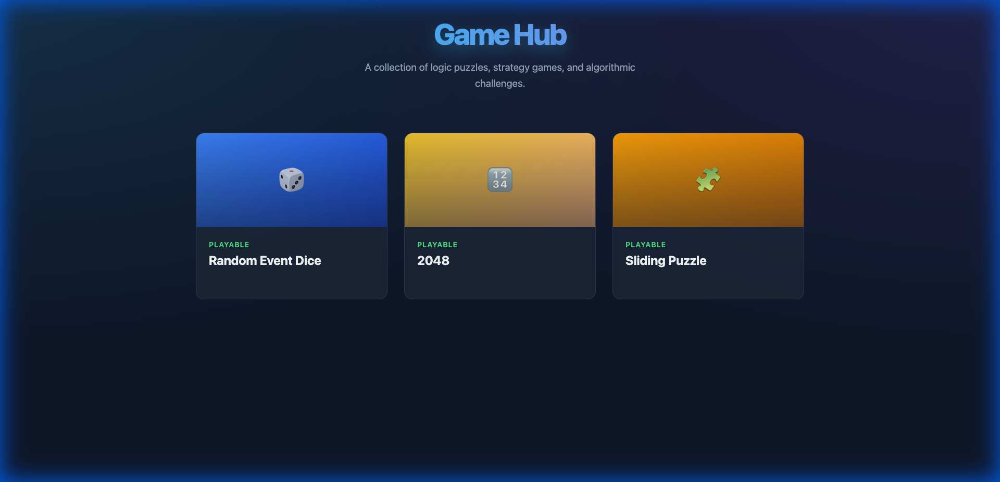
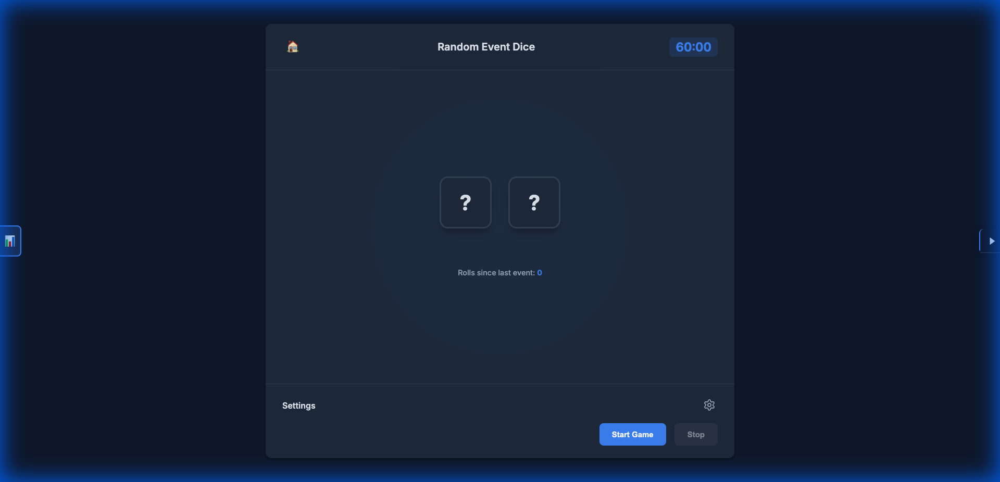
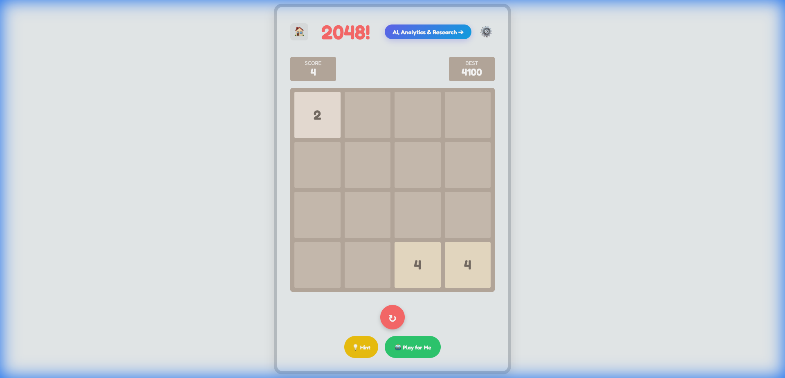
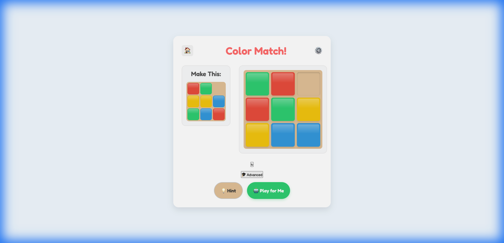
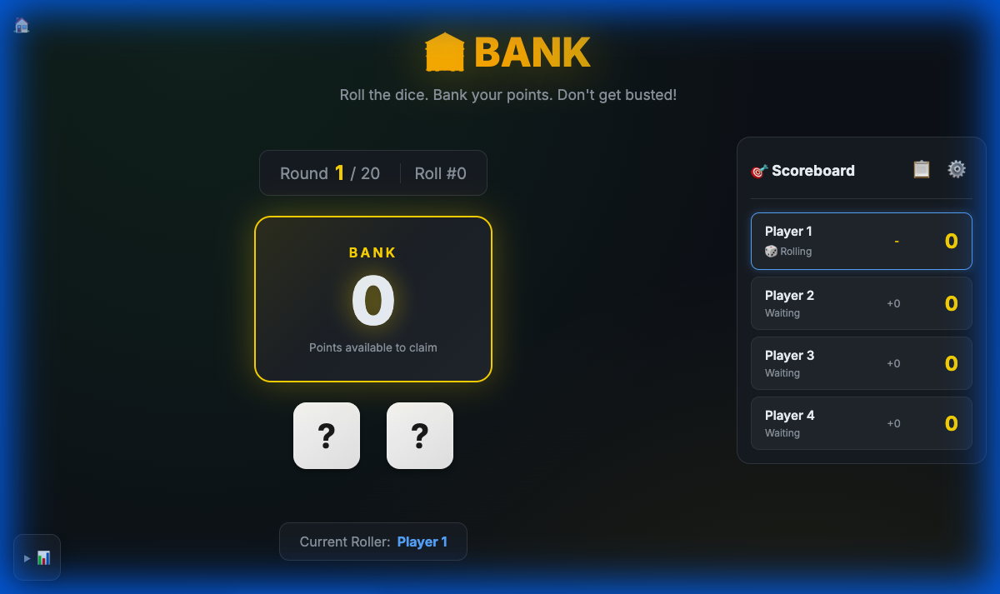

# Overview

## Welcome
Welcome to my games repository! I explore logical aspects and algorithmic solutions to various puzzles and strategy games.

**Live Demo**: [Play the Games Here](https://joeywilkes12.github.io/Games-01-public/index.html)

---

## Redesign preview

This branch previews **3.4.0-alpha.5**, the approved 3D Random Event Dice update on `codex/dice-3d-roll`, including the mobile redesign. The current Pages preview remains **3.4.0-alpha.3** on `codex/mobile-game-lab`. The separate Library design branch uses **3.4.0-alpha.4** and is not included here. `main` remains unchanged. Every HTML page has an Appearance selector with Light, Dark, and live System modes; your choice is shared across pages. Application display versions come from `version.json`; saved-game/configuration schema versions remain independent. See [changelog](CHANGELOG.md) and [versioning policy](docs/versioning.md).

Run the static app locally from this folder:

```sh
python3 -m http.server 4173 --bind 127.0.0.1
```

Open [the hub](http://127.0.0.1:4173/) or [the 2048 lab](http://127.0.0.1:4173/dashboard.html). The lab separates results, inspectable run records and annotated research. [Source audit and PDF extraction instructions](docs/research-notes.md) document the historical observations and local-only research corpus.

## Reading pages

[About Game Hub](docs/about.md) introduces the project. The [Changelog](CHANGELOG.md), this README, versioning, research notes, PDF extraction, and testing guide have themed HTML editions linked from the site. They are pre-rendered and work without JavaScript; appearance preferences use the shared selector.

To refresh the committed HTML after editing a public Markdown source, use Python 3.10 or newer:

```sh
python3 -m venv /tmp/game-hub-docs
/tmp/game-hub-docs/bin/python -m pip install -r scripts/requirements-docs.txt
/tmp/game-hub-docs/bin/python scripts/build-docs.py
/tmp/game-hub-docs/bin/python scripts/build-docs.py --check
```

The generator rejects unresolved local links and rewrites document links to HTML. Edit the Markdown sources, then regenerate and commit their HTML editions together. The reusable `assets/qr/changelog.svg` encodes the live changelog URL, retains a four-module quiet zone, and stays black on white in both appearances.

## Game Gallery — earlier interface screenshots

### Game Hub


### Random Event Dice


### 2048


### Sliding Puzzle 3x3


### Bank


---

## Playable Games
- [Random Event Dice (v2.0)](apps/games/Random%20Event%20Dice/index.html)
- [2048](apps/games/2048/index.html)
- [Sliding Puzzle 3x3](apps/games/Sliding%20Puzzle%203x3/index.html)
- [Bank](apps/games/Bank/index.html)

## Coming Soon / In Development
- [Acquire](#acquire-coming-soon)
- [Mastermind](#mastermind-coming-soon)
- [Queens](#queens-coming-soon)
- [Wordle](#wordle-coming-soon)
- [Risk](#risk-coming-soon)

## Development & Deployment

### Virtual Environment & Reproducibility
This codebase consists largely of static web applications (HTML/CSS/JS) that do not require complex backend runtimes or build steps for the final user. Tests and local development servers differ slightly by game (some use Node.js for testing), but the core games are designed to be "unzipped and played" in any modern browser.

Reproducibility is ensured through semantic versioning of game logic and deterministic seeds in games like Random Event Dice and 2048, allowing users to replay specific scenarios.

### Deployment (GitHub Pages)
This repository is deployed using [GitHub Pages](https://pages.github.com/).
- **Source**: The root (`/`) of `codex/mobile-game-lab`, published directly as a preview without merging into `main`.
- **Build**: GitHub’s generated Pages workflow serves the static files; `.nojekyll` bypasses Jekyll processing. Future pushes to this branch trigger publication after the workflow succeeds.
- **Scope**: `main` remains the default branch. Local research PDFs and review screenshots are ignored and are not published.
- **Appearance**: Every HTML page supports Light, Dark, and System modes.

### Testing

This project uses [Playwright](https://playwright.dev/) for E2E testing and demo recordings.

**Quick Start:**
```bash
./run-all-tests.sh
```

**Available Commands:**
- `npx playwright test --project=tests` - Run all unit/seeded tests
- `npx playwright test --project=demo` - Run demo recording (creates video)
- `npx playwright show-report` - View interactive test report

See [tests.md](tests.md) for complete test documentation.


## Acknowledgements & AI Investment
This project was developed with significant assistance from advanced AI tools, representing a financial investment in state-of-the-art technology to explore the future of coding.
Options:
- `--demo`: Run full demo recording.
- `--split`: Run split parallel demos.
- `--headed`: Run in visible browser.
- `--speed=2.0`: Run at 2x speed.

### 2048
A single-player sliding block puzzle using numbered tiles. Features an Expectimax AI solver, multiple themes, and seeded randomness for reproducible runs.

### Sliding Puzzle 3x3
A classic sliding tile puzzle where the player must rearrange scrambled tiles into a specific order.

### Bank
A multiplayer dice game based on rules from [ThunderHive Games](https://www.thunderhivegames.com/). Players take turns rolling dice to accumulate points in a shared "bank", then strategically decide when to claim those points. Rolling a 7 ends the round and loses unbanked points (except the first 3 rolls which are protected). Doubles double the bank!

### Acquire (Coming Soon)
A strategic board game involving the placement of tiles to form and expand corporations. Players buy stock in active chains and earn bonuses when chains merge.

### Mastermind (Coming Soon)
A logic-based code-breaking game where the player guesses a secret color pattern.

### Queens (Coming Soon)
A classic constraint satisfaction puzzle requiring the placement of N queens on an NxN chessboard so that no two queens threaten each other.

### Wordle (Coming Soon)
A word-guessing game relying on information theory and entropy to maximize information gain with each guess.

### Risk (Coming Soon)
A complex board game of global domination involving territory control, combat, and alliances.
